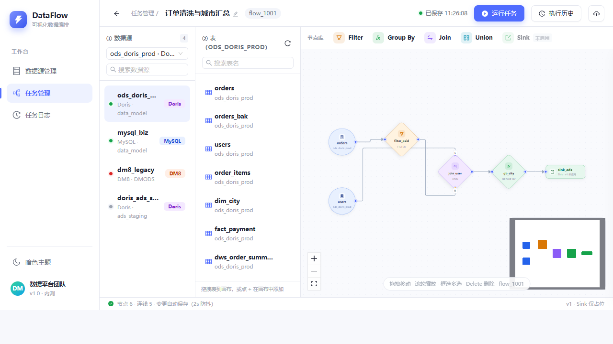
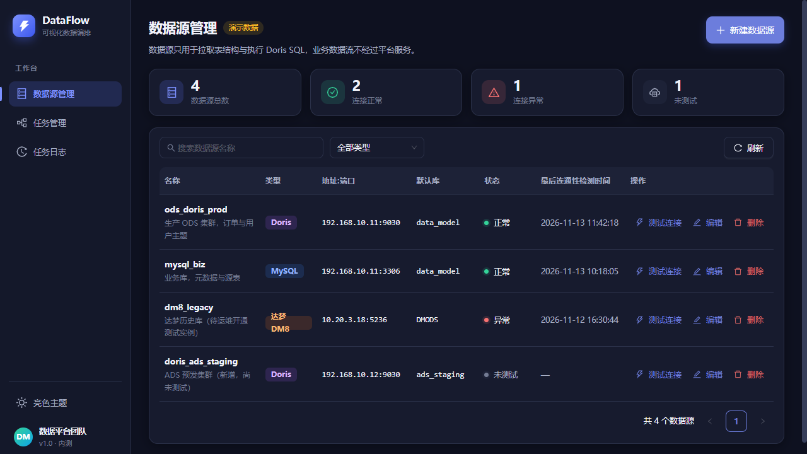
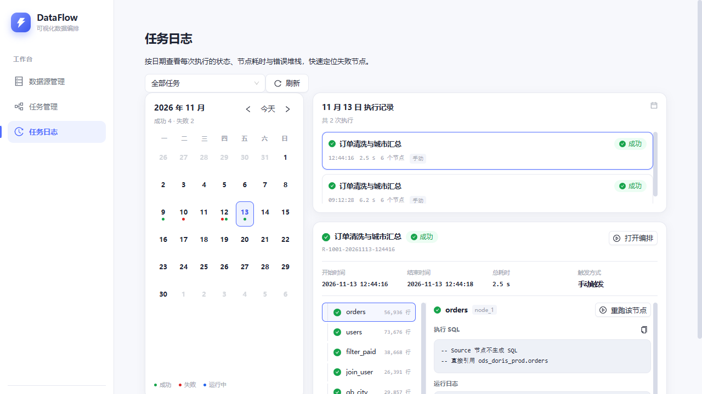

# DataFlow · 可视化数据编排平台（前端）

工程目录：`D:\work\code\data-model-muse\data-model\data-model-frontend`

Vite 5 + React 18 + TypeScript 5 + React Flow 12 + Zustand 5 + Ant Design 5。

## 启动

```bash
npm install

# 演示模式：数据源、任务、日志全部使用本地 Mock 数据
npm run dev:mock

# 接入后端：数据源走真实 /api/data-source，任务与日志暂用 Mock
npm run dev

# 生产构建
npm run build
npm run preview
```

默认访问 `http://localhost:5173`。若端口被占用，Vite 会自动顺延并在终端输出实际地址。

环境变量见 `.env.example`：

| 变量 | 说明 |
| --- | --- |
| `VITE_API_TARGET` | `/api` 代理目标，默认 `http://127.0.0.1:8080` |
| `VITE_USE_MOCK` | `true` 时数据源也使用本地 Mock；`false` 时请求真实后端 |

> 不在代码、配置或文档中保存任何真实数据库密码。后端连接信息由后端环境变量管理。

## 页面入口

| 路由 | 页面 |
| --- | --- |
| `/data-source` | 数据源管理：列表、搜索、类型筛选、新建/编辑、删除、测试连接 |
| `/flow` | 任务管理：任务卡片、创建、重命名、复制、删除 |
| `/flow/:flowId/editor` | 可视化编排：三栏布局、拖拽建节点、连线、配置抽屉、自动保存、模拟执行 |
| `/logs` | 任务日志：月历、执行批次、节点耗时、SQL、错误堆栈 |







## 已实现

### 主题体系（Astryx）

- `src/styles/tokens.css`：主色、语义色、中性色、字号/行高、圆角、阴影、间距，支持 `html[data-theme="dark"]`。
- `src/theme/ThemeProvider.tsx`：Ant Design `ConfigProvider` token + `darkAlgorithm`，统一 Button/Table/Drawer/Modal 外观。
- `AppLayout` 左侧导航固定三项：数据源管理 / 任务管理 / 任务日志；右下角主题切换持久化到 `astryx.theme`。

### 数据源管理

- 对齐后端契约：`GET/POST /api/data-source`、`PUT/DELETE /api/data-source/{id}`、`POST /api/data-source/{id}/test`、`GET /api/data-source/{id}/tables`、`GET /api/data-source/{id}/tables/{table}/columns`。
- 支持 MySQL / Doris / DM8；密码 AES-256-GCM 由后端加密，前端只负责输入，不落地保存。
- 连接测试失败（HTTP 400 + `code=4004`）在表单内展示错误信息，仍允许保存并标记为「异常」。
- 测试连接结果按 PRD 六类映射中文文案（连接被拒/认证失败/库不存在/超时/驱动缺失/其他），见 `src/utils/connectionError.ts`；后端返回 `errorType` 时优先使用。
- 表/字段接口兼容后端 `name`、`columnName` 字段（D-08），映射为前端 `tableName`、`name`。
- 错误响应统一由 `src/api/http.ts` 解析 `{ code, data, msg }`。

### 可视化编排

- 三栏：数据源列 → 表列表列 → 画布；表可拖入画布生成圆形 Source 节点，也可点击 `+` 添加。
- 节点库：Filter / Group By / Join / Union / Sink，可拖拽或点击添加到画布中心。
- 自定义节点：
  - Source：96px 圆形，仅输出口；
  - Transform：118×118 菱形，Join 为上下两个输入口（L/R），其余为左侧单输入口；
  - Sink：140×48 矩形，仅输入口，v1 仅占位。
- 连线即时校验：自连、重复连线、环路、Source 入线、Join 超过 2 条入线、输入口重复、Filter/GroupBy/Sink 多入线，均以中文 toast 拦截；保存与执行前再次校验。
- 画布支持缩放、平移、框选、多选删除、MiniMap、Controls、自动 fitView；节点警告徽标会提示缺表、Join 未配齐、Group By 无分组等。
- 配置抽屉：字段投影、过滤条件（AND/OR、括号缩进、常量/字段比较）、分组聚合、HAVING、Join 键与投影、Union 字段对齐、SQL 预览与示例数据预览。
- 自动保存：结构变更 2s 防抖写入 DAG（节点、连线、视口、配置 JSON）；顶部展示未保存/保存中/已保存/失败状态。
- `dag_json` 按 PRD §12 / API 契约 §5 序列化（`src/utils/dagJson.ts`）：节点类型 `groupby`、Filter `passthrough`、GroupBy `groupBy/fn`、Join `leftAlias/rightAlias/extraOn[]`、Union `mode/align/inputs/outputs`、Sink 占位空配置、边 `sourceHandle:"out"`。样例见 `docs/dag-json-sample.json`。
- 模拟执行：按 DAG 顺序推进节点状态，生成执行记录并写入日志；Sink 标记为 SKIPPED。真实执行引擎在 M4 接入。

### 任务日志

- 月历按天标记成功/失败/运行中，可切换月份、回到今天。
- 按日期列出执行批次，展示状态、耗时、节点数、触发方式。
- 节点级详情：状态、行数、耗时、执行 SQL（可复制）、运行日志、错误堆栈；支持跳转编排页。

## 目录结构

```
src/
  api/            axios 封装、数据源接口、任务 Mock 接口
  components/     状态标签、空状态、SQL/数据预览弹窗
  layouts/        统一 AppLayout
  pages/
    DataSource/   数据源列表与表单抽屉
    FlowList/     任务卡片列表
    FlowEditor/   画布、三栏、节点、配置面板、Zustand store
    Logs/         月历与执行详情
  styles/         tokens.css / global.css
  theme/          ThemeProvider
  utils/          节点元数据、DAG 工具、SQL 生成、连线校验
  types/          前后端共享类型定义
```

## Mock 说明

- Mock 数据写入浏览器 `localStorage`，首次访问自动生成演示数据源、3 个任务和 5 条执行记录。
- 重置演示数据：在浏览器控制台执行 `localStorage.clear()` 后刷新。
- 任务与日志使用 Mock 是阶段性安排；数据源页面可通过 `VITE_USE_MOCK=false` 直接连真实后端。

## 已验证

- `npm run build` 通过（TypeScript + Vite，3160 modules）。
- 真实后端联调（`npm run dev`，代理到 `127.0.0.1:8080`，2026-11-13）：
  - 列表渲染 `doris_demo`；测试连接成功提示「连接成功（耗时 22ms）」。
  - 新建临时数据源 → 保存成功；测试失败提示「无法连接到 127.0.0.1:3306，请检查地址、端口与网络连通性」，状态转「异常」。
  - 编辑保存成功；删除二次确认后删除成功，测试数据已清理、无残留。
  - 12 张真实表正确显示表名，点 `+` 生成 Source 节点并读取 qa_orders 12 个字段（D-08 已修复）。
- 编排页验证：三栏布局、6 类节点、节点配置抽屉、自动保存、连线校验、明暗主题均正常；保存出的 `dag_json` 与 PRD §12 逐字段核对通过。
- 连线校验函数已用当前 DAG 验证：重复连线、自连、Join 第三条入线均返回中文原因。
- 尚未验证：真实 Doris 执行引擎（M4）、鼠标拖拽连线的自动化回归（当前依赖人工操作）、真实任务/日志接口（仍为 Mock，待 M3/M4）。

## 后续接入点

1. `src/api/flow.ts` 将 `flowMock` 替换为后端 `/api/flow` 接口，`dag_json` 结构保持不变。
2. `src/pages/FlowEditor/index.tsx` 的模拟执行替换为执行接口 + 轮询/WebSocket 状态。
3. Sink 节点在写入能力上线后移除禁用态。
